  
  
  

##  About

**Softonia** builds practical software — from websites and internal portals to mobile apps and AI-assisted tools.

- 🔭 &nbsp;Shipping web and mobile products end to end
- 🤖 &nbsp;Exploring how AI can make everyday software smarter
- 🇱🇰 &nbsp;Based in Sri Lanka, building for everywhere
- 🤝 &nbsp;Open to collaboration and new project ideas

##  What we build

  

##  Open source

##  GitHub stats

##  Contribution snake

<picture>
  <source media="(prefers-color-scheme: dark)" srcset="https://raw.githubusercontent.com/softonialk/softonialk/output/snake.svg" />
  <source media="(prefers-color-scheme: light)" srcset="https://raw.githubusercontent.com/softonialk/softonialk/output/snake-light.svg" />
  
</picture>

##  Get in touch

Have an idea or want to work together? Open an issue or start a discussion on any repository.

